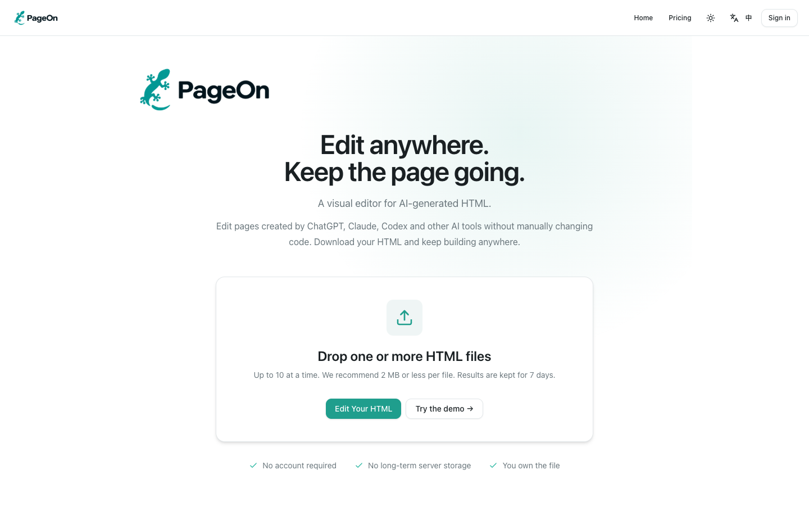

# PageOn

[English](README.md) · [简体中文](README.zh-CN.md)

A local HTML editor with a portable editing runtime. Open a file, convert it through the PageOn API, edit its text and download an HTML copy that remains editable.

[](https://pageon.cc/)

*The [PageOn website](https://pageon.cc/). Run the open-source editor locally with the steps below.*

**No sign-in, payments, API key or database setup is required.** The application starts locally; conversion of uploaded files uses a remote service. The bundled example works without that service.

The interface defaults to English. Use the **language icon + 中 / EN** button in the header to switch the home screen, editor and exported toolbar to Chinese. Your choice is remembered in this browser when storage is available. Switching languages keeps the current draft and does not translate the document content.

The example opens in the current interface language: English opens the English example; Chinese opens the Chinese example. Changing the interface language after opening does not replace the document content. Build output includes English examples and Chinese `.zh-CN.html` variants.

## Quick start

Requirements: Node.js 22.12 or newer and npm 10 or newer.

```bash
npm install
npm run dev
```

Open the local URL printed in the terminal, normally `http://127.0.0.1:5173`. No `.env` file is required. Click **Try an offline example** to start immediately, even if the remote conversion endpoint is unavailable.

For a clean reproducible installation, use `npm ci` instead of `npm install`.

## Use your own HTML

1. Choose or drop an `.html` or `.htm` file, up to 1 MiB.
2. Conversion starts automatically and opens the editor when complete. If it fails, use **Retry conversion**.
3. Edit static text, including supported SVG text. Switch to **Done** to preview the original page interactions.
4. In the editor, choose a floating or sidebar toolbar for the exported file and select **Download HTML**.
5. Open the downloaded file directly and use its built-in editing controls.

Files, converted results and drafts stay in tab memory after conversion. **Download before refreshing or closing the tab.** A started browser download does not guarantee the file was saved by the browser. External fonts, images, scripts and CDN resources in your document may still require a network connection.

## Notes and presentation cues

Select content in the editor, open **Notes**, enter a note; changes apply immediately. Notes work on ordinary pages too. Numbered markers indicate annotated content; click one to read the note for 2 seconds. Notes are saved in the HTML and remain available when reopened. In an exported HTML file, enter edit mode, select an element or a text range, then click **Notes** in the editing toolbar to add, edit, or delete a note. Note color is configurable with ten swatches in standard and premium files. Numbered markers and selected-text highlights use the chosen color, independently of character color. Selected-text notes highlight only that text with black lettering; deleting the note restores the original formatting. The compact white panel closes when selecting another element or clicking outside, anchors to the toolbar button like the color picker, and stays within the viewport as it resizes. The standard text toolbar follows selected content; dragging pins it until another selection. Changes apply immediately; use **Save** or **Save copy** to keep them in the HTML. No re-import or sign-in is required.

In slides, each Space press shows the next note on the current slide. After all notes have been shown, the next press delegates to the page's existing right-arrow handler to advance. Slides without notes advance immediately. Holding Space triggers only once; left/right arrows keep their original behavior. Returning to a slide restarts its note sequence. This version recognizes `.slide`, `[data-slide]` and Reveal slide structures. Pages without arrow-key navigation or with entirely script-generated content need an adapter.

By default, automatic detection shows numbers in ordinary documents and hides them while previewing or presenting slides; editing shows the numbers. Text highlight backgrounds remain visible and configurable. In the Notes panel, **Note markers (whole document)** offers **Auto / Always show / Show only while editing**. This preference is saved in the HTML, with no URL changes needed. Detection uses slide structure and page dimensions and excludes common carousels; use the setting to correct unusual documents.

Legacy links remain supported: open `slides.html?pageon-notes=off` to hide only the numbered note markers. Text highlights, note editing, and Space-key presenter cues remain available. Use `&pageon-notes=off` if there are other query parameters, before any `#` fragment. This does not remove notes from the HTML. Sharing an entire screen shares the same visible cues. This version does not synchronize separate presenter and audience windows.

The open-source editor does not require sign-in for notes or exports. The PageOn website requires sign-in to export HTML with notes; the downloaded file does not require sign-in to view notes offline. Text notes use free standard export without Credits. PNG image and PDF exports are also free; the website requires sign-in for these exports. Character notes with built-in characters or custom images and random animations require premium export on the website, at 1 Credit per HTML file. Standard offline files provide text-note controls; editing, playing and saving character notes locally after premium export incurs no further charges.

## Conversion API

HTML conversion automatically uses the official PageOn API. **No environment variables, API key or service setup are required.**

```text
https://pageon.cc/api/open-source/transform
```

An internet connection is required to convert your own files. Your HTML is sent to PageOn for conversion; editing and downloading happen locally afterward. The bundled examples work without the conversion service.

The official API returns HTML with PageOn branding and a fixed link to **https://pageon.cc**. If conversion fails or the service is busy, retry later.

## Customize editing interactions

The same Runtime powers floating controls, a sidebar, and custom controls. PageOn attribution remains visible and links to **https://pageon.cc**. No public option disables, renames or redirects it. Website paid exports remain a separate official service.

```js
import { createRuntime } from '@pageon/runtime';

// Only mount directly into a trusted document, never an untrusted upload.
const runtime = createRuntime({
  document,
  fileName: 'my-page.html',
  ui: 'sidebar', // 'floating', 'sidebar', or false for custom controls
});

runtime.enterEdit();
runtime.on('selectionchange', selection => console.log(selection));
runtime.exitEdit();
await runtime.save();
```

`ui: false` hides the built-in editing buttons, not the brand. The controller exposes `enterEdit`, `exitEdit`, `getSelection`, `apply`, `serialize`, `save`, `saveCopy`, `on` and `destroy`. The controller is also available as `window.PageOnRuntime` in exported files. `Ctrl+Alt+E` toggles editing; `Ctrl+S`, `Cmd+S` and `Ctrl+Alt+S` save.

In supported browsers, **Save** opens a save dialog prefilled with the current file name. Confirm replacement in the original folder once; subsequent saves write to that destination for the current page session without reopening the picker or replacement confirmation. Opening a local HTML file alone does not grant write access; reloading or reopening requires confirming the destination again. A cancelled or failed write never silently downloads a replacement. Unsupported browsers show **Save copy**. The **Export** menu contains **Save a copy**, **Export image** and **Export PDF** when visual export is enabled; `saveCopy()` always requests a separate HTML download.

`apply({ type: 'set-text', nodeId, value })` edits a selected plain-text node. It rejects structured nodes with child elements so links and formatting are not silently replaced. The node ID is stable within an editing session, not a universal ID across arbitrary document rewrites. `serialize()` synchronously returns `{ html, fileName, runtimeVersion }`. `save()` uses a single-flight guard and returns a Promise.

An optional `onSave(artifact)` callback changes the host's `save()` behavior for the current session. JavaScript closures and host callbacks are not serialized into downloaded files; those files use the default file-selection or copy-download behavior. Use the `examples/custom-controls.html` example for self-contained custom controls. Mark their UI container with `data-pageon-extension` so it is not editable; such temporary UI is removed from saved copies and recreated by its own script.

The Runtime factory serializes self-contained functions. The provided build preserves these functions without minification. Custom bundlers must preserve this behavior and test the actual saved HTML, not only the application bundle.

## Build and test

```bash
npm test
npm run build
npm run preview
```

`dist/` contains the static application. `dist/runtime/pageon-runtime.js` is a self-contained browser script. The root `examples/` directory contains standalone HTML examples checked into the repository, so you can open them without installing dependencies or building:

| Controls | English | 简体中文 |
| --- | --- | --- |
| Floating | [Open example](examples/floating.html) | [打开示例](examples/floating.zh-CN.html) |
| Sidebar | [Open example](examples/sidebar.html) | [打开示例](examples/sidebar.zh-CN.html) |
| Custom | [Open example](examples/custom-controls.html) | [打开示例](examples/custom-controls.zh-CN.html) |

The examples are generated from the shared sample and Runtime. After changing their source, regenerate them with:

```bash
npm run build:runtime
```

## Project structure

```text
examples/              Standalone English and Chinese HTML examples
apps/playground/       Local application
packages/editor/       Shared React editor and isolated preview
packages/runtime/      Portable editing runtime and HTML assembly
packages/protocol/     Public conversion contract
packages/api-client/   Anonymous conversion client
packages/ui/           Editor UI dependencies
tests/public/          Tests independent of the private converter
scripts/               Runtime/example builds
```

All workspace packages are local and marked `private: true`. No npm publication is required to run this project.

## Compatibility and boundaries

- Static HTML and supported SVG text can be edited and saved.
- Editing uses a script-disabled document; interactive preview uses a separate opaque-origin iframe. Do not combine `allow-scripts` and `allow-same-origin` for untrusted uploads.
- React/Vue-managed dynamic text is not written back into JSX, component state or templates. Runtime edits to such text may be temporary.
- The sample fixture is trusted, original content. It is not a sanitizer for uploaded HTML.
- There is no template marketplace, paid template content, cloud file storage or checkout in this app.
- Brand rules describe the official API and unmodified distribution; editable source and HTML cannot provide absolute tamper prevention.

## Contributing and license

Issues and contributions are welcome. See [CONTRIBUTING.md](CONTRIBUTING.md).

PageOn-authored code, documentation and original examples in this repository are licensed under the **MIT License**. See [LICENSE](LICENSE) and [THIRD_PARTY_NOTICES.md](THIRD_PARTY_NOTICES.md). The private converter, account and payment systems, and paid templates are outside this distribution and its license.

The official conversion API for this app always returns HTML with PageOn branding and a fixed `https://pageon.cc` link; callers cannot disable or replace either. The official Runtime and application retain this behavior. These are official service and product rules, not additional MIT conditions: MIT permits modified versions, including changes to the branding code, provided the required copyright and permission notices are retained. The software license does not imply PageOn endorsement of a fork.
