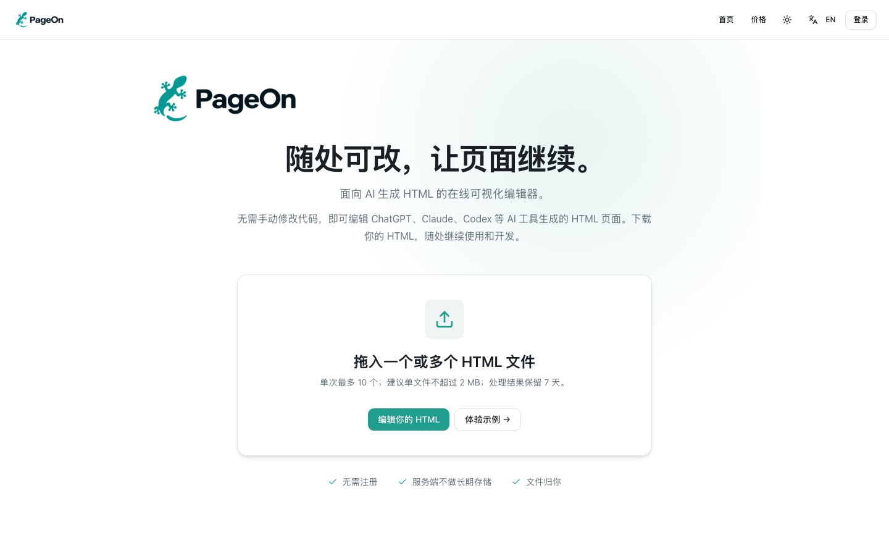

# PageOn

[English](README.md) · [简体中文](README.zh-CN.md)

可以本地运行的 HTML 编辑器。通过官网 API 转换 HTML 后，本地编辑并下载；导出的文件自带编辑 Runtime，重新打开后可以继续修改。

[](https://pageon.cc/zh)

*[PageOn 官网](https://pageon.cc/zh)预览。开源编辑器可按下方步骤在本地运行。*

**无需登录、支付、API Key 或数据库。** 本地启动与完全离线处理是两回事：上传自己的文件需要远程转换；内置示例不依赖转换服务。

界面默认使用英文。通过顶部 **语言图标 + 中 / EN** 按钮 可切换首页、编辑器及导出工具栏的语言；浏览器允许存储时会记住选择。切换语言会保留当前编辑内容，不会翻译文档正文。

示例按进入时的界面语言打开：英文界面打开英文示例，中文界面打开中文示例。打开后切换界面语言不会替换文档正文。构建产物包含英文示例及中文 `.zh-CN.html` 版本。

## 本地启动

需要 Node.js 22.12 或更新版本，以及 npm 10 或更新版本。

```bash
npm install
npm run dev
```

打开终端显示的地址，默认是 `http://127.0.0.1:5173`。无需配置 `.env`。点击 **Try an offline example** 即可使用内置示例，即使远程服务不可用也能编辑和下载。复现锁文件中的依赖时使用 `npm ci`。

## 编辑自己的文件

1. 选择或拖入 `.html` / `.htm` 文件，最大 1 MiB。
2. 自动开始转换，完成后直接进入编辑；失败时可点击 **重试转换**。
3. 编辑静态文字或支持的 SVG 文字，点击 **Done** 预览原页面交互。
4. 在编辑界面中选择导出文件的浮动工具栏或侧边栏，点击 **Download HTML**。
5. 直接打开下载的文件，用内置工具栏继续编辑。

转换后的文件和草稿只保存在当前标签页内存中。**刷新或关闭前请下载保存。** 下载已启动不等于浏览器已成功保存文件。原 HTML 的外部图片、字体、脚本和 CDN 资源仍可能需要网络。

## 批注与演讲提示

在编辑器中选择正文，打开 **批注**，输入内容后即时生效。普通网页也能使用；有批注的位置显示编号标记，点击可查看，2 秒后隐藏。批注随 HTML 保存，导出文件重新打开后，进入编辑模式，选择元素或划选文字，再点击编辑工具栏的 **批注**，即可新增、修改或删除。普通和高级文件都支持从 10 种颜色中选择批注颜色，编号标记和选中文字的高亮使用所选颜色，与角色颜色独立设置。文字批注仅高亮选中的文字并使用黑字，删除批注后恢复原来的文字样式。批注使用白色紧凑浮窗，切换元素或点击外部时收起，像颜色选择器一样定位在工具栏按钮旁，窗口大小变化时自动限制在可视区域内。普通版的文字编辑工具栏会跟随选中内容定位；手动拖动后保留位置，直到重新选择内容。修改即时生效，使用 **保存** 或 **保存副本** 写入 HTML，无需重新导入或登录。

幻灯片中，每按一次空格显示当前页下一条批注。全部显示完后，再按空格才交给原页面的右方向键逻辑翻页；无批注的页直接翻页。长按只触发一次，左右方向键保持原有行为，返回一页后从第一条批注重新开始。首版识别 `.slide`、`[data-slide]` 和 Reveal 的页面结构；没有方向键控制器或完全由脚本生成内容的页面，需要单独适配。

默认自动判断文档形式：普通 HTML 阅读时显示序号，识别为演示稿后在预览和播放时隐藏序号，编辑时显示。划选文字的高亮背景始终保留，颜色仍可配置。批注面板中的 **批注标记（整个文档）** 可选择 **自动 / 始终显示 / 仅编辑时显示**，设置随 HTML 保存，无需修改 URL。自动识别结合幻灯片结构与页面尺寸，排除常见轮播；特殊页面可手动调整。

兼容旧链接：打开 `slides.html?pageon-notes=off` 仅隐藏正文的批注编号，文字高亮、批注编辑和空格演讲提示均保留；已有查询参数时使用 `&pageon-notes=off`，参数放在 `#` 之前。此参数不删除 HTML 内的批注。共享整个屏幕时，观众会看到相同画面；本版本没有双窗口同步。

开源编辑器的批注和导出无需登录。PageOn 官网要求登录后导出带批注的 HTML；导出的文件离线查看批注不再验证登录。文字批注可免费普通导出，PNG 图片和 PDF 导出也免费，均不扣积分（官网图片和 PDF 导出需登录）；带内置角色或自定义图片及随机动画的角色形象批注需官网高级导出，每份 HTML 消耗 1 Credit。普通离线文件仅提供文字批注配置，高级导出后在本地编辑、播放和保存角色批注不再扣费。

## 官网转换 API

HTML 转换默认直接调用 PageOn 官网 API，**无需配置环境变量、API Key 或自行搭建服务**。

```text
https://pageon.cc/api/open-source/transform
```

转换自己的文件需要联网，HTML 会发送到官网进行转换；后续编辑和下载在本地完成。内置示例不依赖转换服务。

官方接口生成的 HTML 带有 PageOn 品牌，链接固定为 **https://pageon.cc**。遇到转换失败或服务繁忙时，稍后重试即可。

## 定制交互

浮动工具栏、侧边栏和自定义控件使用同一个 Runtime。品牌保留，跳转固定为 **https://pageon.cc**，不提供关闭、替换或修改地址的公共配置。官网付费去品牌属于独立的官方服务。

```js
import { createRuntime } from '@pageon/runtime';

// 只对可信文档直接挂载；不要直接挂载未经处理的上传内容。
const runtime = createRuntime({ document, fileName: 'my-page.html', ui: 'sidebar' });
runtime.enterEdit();
runtime.on('selectionchange', selection => console.log(selection));
runtime.exitEdit();
await runtime.save();
```

`ui` 支持 `floating`、`sidebar`、`false`。`false` 只隐藏默认编辑按钮，品牌仍保留。控制器提供 `enterEdit`、`exitEdit`、`getSelection`、`apply`、`serialize`、`save`、`saveCopy`、`on` 和 `destroy`；导出文件中也可通过 `window.PageOnRuntime` 使用。`Ctrl+Alt+E` 切换编辑，`Ctrl+S`、`Cmd+S` 或 `Ctrl+Alt+S` 保存。

支持文件写入的浏览器显示“保存”：首次弹出保存窗口并自动带入当前文件名，在原文件夹中确认同名覆盖后，本次页面会话内再次保存直接写回该文件，不再弹出文件选择或覆盖确认。双击打开 HTML 本身不授予写入权限，刷新或重新打开后需要再次确认保存位置。取消或写入失败不会自动下载副本。不支持的浏览器显示“保存副本”。“导出”菜单保留“另存副本”，启用图片导出时还包含“导出图片”和“导出 PDF”；`saveCopy()` 始终请求单独下载 HTML。

`apply({ type: 'set-text', nodeId, value })` 用于纯文字节点，不会覆盖包含子元素的复杂结构。节点 ID 只在本次编辑会话中稳定。`serialize()` 同步返回 `{ html, fileName, runtimeVersion }`；`save()` 返回 Promise，防止同一实例重复执行保存。

`onSave(artifact)` 可替换当前宿主的 `save()` 行为，但闭包和回调不会自动写进下载文件；下载文件默认使用文件选择授权或下载副本。需要自包含的定制控件时参考根目录的 `examples/custom-controls.html`。控件容器标记 `data-pageon-extension`，避免被识别成可编辑正文；保存时清除临时控件，重新打开时由其脚本重建。

Runtime 使用自包含函数生成单文件脚本，项目提供的构建不压缩这些函数。更换构建工具时，需要验证生成并保存的 HTML 能继续运行。

## 构建与测试

```bash
npm test
npm run build
npm run preview
```

`dist/` 包含本地应用的静态产物，`dist/runtime/pageon-runtime.js` 为自包含脚本；根目录 `examples/` 中的示例会随仓库一起提供，无需安装依赖或构建，即可下载后双击打开。

| 工具栏 | English | 简体中文 |
| --- | --- | --- |
| 悬浮 | [Open example](examples/floating.html) | [打开示例](examples/floating.zh-CN.html) |
| 侧边 | [Open example](examples/sidebar.html) | [打开示例](examples/sidebar.zh-CN.html) |
| 自定义 | [Open example](examples/custom-controls.html) | [打开示例](examples/custom-controls.zh-CN.html) |

示例由共享示例源码与 Runtime 自动生成。修改源码后，运行 `npm run build:runtime` 更新示例，避免直接维护生成的 HTML。

源码目录：`apps/playground` 是本地应用，`packages` 下包含共享编辑器、Runtime、公开协议、客户端和必要 UI，`tests/public` 是不依赖私有转换器的测试。所有包保持 `private: true`，本地运行不要求发布 npm。

## 能力边界

- 支持静态 HTML 和 SVG 文字；React/Vue 动态文字不承诺回写组件源码、状态或模板。
- 编辑文档禁用原脚本；交互预览使用隔离来源。不要同时给上传内容开放 `allow-scripts` 与 `allow-same-origin`。
- 内置示例是原创可信内容，不是任意上传 HTML 的清洗器。
- 不包含模板广场、付费模板、云文件存储或收银台。
- 品牌约束适用于官方 API 与未修改的发行版；源码和 HTML 可编辑，不能提供绝对防篡改保护。

## 贡献与许可

欢迎反馈问题和贡献改进，详见 [CONTRIBUTING.md](CONTRIBUTING.md)。

本仓库中 PageOn 原创代码、文档和示例采用 **MIT 许可证**。参见 [LICENSE](LICENSE) 和 [第三方说明](THIRD_PARTY_NOTICES.md)。私有转换核心、账户支付系统及付费模板不在本发行目录及其许可范围内。

本项目使用的官方转换接口必须生成带 PageOn 品牌的 HTML，链接固定为 `https://pageon.cc`，调用方不能通过参数关闭品牌或更换链接。官方 Runtime 和应用保持这一行为。这是官方服务和产品规则，不是 MIT 的附加限制：在保留必要版权与许可声明的前提下，MIT 允许修改软件，包括品牌相关代码。代码许可不代表 PageOn 对第三方分支的背书。
